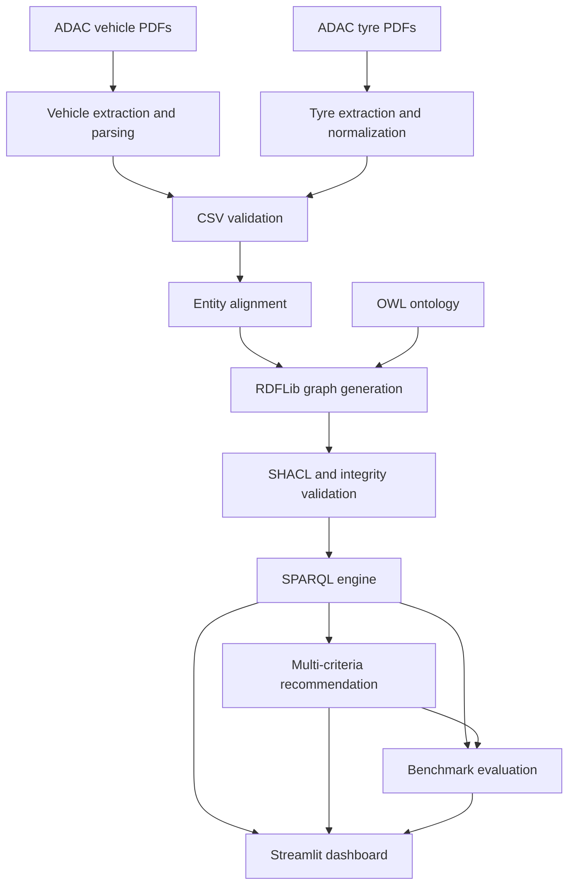

# AutoEcoKG — Automotive Environmental Knowledge Graph

Academic research prototype for the **Creation and Application of Knowledge Graphs** course, M.Sc. Computer Science, Leibniz University Hannover.

AutoEcoKG represents passenger-car specifications, declared and independently tested consumption, CO₂ emissions, tyre abrasion and tyre safety observations as a provenance-aware RDF/OWL graph. It supports SPARQL queries, multi-criteria tyre rankings and an interactive Streamlit dashboard. It is **not** a certified vehicle-fitment service.

## Research questions

- How do declared WLTP and ADAC-tested fuel or electricity consumption differ for comparable observations?
- Which tested tyre variants have the lowest measured abrasion?
- Which tyre variants balance low abrasion and favourable safety grades at a selected dimension and season?
- Which vehicle reports describe tyres matching an independently tested tyre model and size?
- Which source document, page and test context support a measurement?

## Current dataset snapshot

The figures below refer to the locally validated project snapshot, not the complete German vehicle or tyre market.

| Item | Count |
| --- | ---: |
| RDF triples | 26,834 |
| Vehicle variants | 26 |
| Provisional tyre entities | 162 |
| Vehicle observations | 632 (609 extracted + 23 derived) |
| Tyre observations | 1,170 |
| Tyre source records | 194 (160 abrasion + 34 grading) |
| Vehicle–tyre alignment candidates | 161 |
| Source documents | 28 |
| Unresolved tyre alias candidates | 2 |
| Test protocols | 4 |

### Data sources

- ADAC Autotest: 26 individual vehicle reports; reported specifications, declared WLTP values and independent test results. [ADAC Autotest](https://www.adac.de/rund-ums-fahrzeug/autokatalog/)
- ADAC, *Reifenabrieb in der Umwelt: Ergebnisse aus dem ADAC Reifentest und künftige Gesetzgebung*, June 2025. Appendix 1 contains 160 abrasion records from 2023–2025 (84 summer, 60 winter, 16 all-season).
- ADAC, *Sommerreifen 2025 — Reifentests & Reifentipps*, first edition. The extracted tables contain 18 summer tyre test records from 2025 (225/40 R18) and 16 from 2024 (215/55 R17). [ADAC tyre tests](https://www.adac.de/rund-ums-fahrzeug/ausstattung-technik-zubehoer/reifen/reifentest/)
- European Environment Agency (EEA) passenger-car CO₂ registration data: planned, **not integrated** in this snapshot due to access errors.

The raw documents, extracted source evidence and generated datasets are intended to remain local pending confirmation of redistribution rights. Obtain the source reports from their publisher and retain their original filenames (or the filenames used in the local extraction manifest). The tyre parser expects the two filenames shown below. The current source collection is not yet accompanied by a complete public download manifest; reproducing the identical snapshot requires the same source editions and filenames.

## Architecture



The graph uses RDF, RDFS, OWL, SOSA, PROV-O and XSD. Measurement observations connect a feature of interest, measured property, value, unit and context; provenance links them to source documents or, for derived quantities, input observations. The ontology is in `ontology/autoecokg_ontology.ttl`; the generated graph includes the ontology and instances in `data/autoecokg_triples.ttl`.

## Repository structure

```text
AutoEcoKG/
├── data/                         # Local data, not for redistribution
│   ├── raw/
│   │   ├── adac/                 # 26 individual vehicle Autotest PDFs
│   │   ├── tyres/
│   │   │   ├── adac_tyre_abrasion_2023_2025.pdf
│   │   │   └── adac_summer_tyres_2025.pdf
│   │   └── eea/                  # Reserved for future integration
│   ├── intermediate/
│   ├── processed/
│   └── autoecokg_triples.ttl     # Generated locally
├── ontology/
│   ├── autoecokg_ontology.ttl
│   └── shacl_shapes.ttl
├── src/
│   ├── extract_adac_pdfs.py
│   ├── parse_vehicle_data.py
│   ├── validate_vehicle_data.py
│   ├── extract_tyre_data.py
│   ├── parse_tyre_data.py
│   ├── validate_tyre_data.py
│   ├── entity_alignment.py
│   ├── generate_knowledge_graph.py
│   ├── validate_knowledge_graph.py
│   ├── engine.py
│   ├── recommendation.py
│   ├── evaluate.py
│   └── app.py
├── evaluation/                   # Generated benchmark reports / query exports
├── requirements.txt
└── README.md
```

## Setup (Windows PowerShell)

```powershell
git clone https://github.com/YASH123H/AutoEcoKG.git
cd AutoEcoKG
python -m venv .venv
.\.venv\Scripts\Activate.ps1
python -m pip install -r requirements.txt
```

Core libraries include PyMuPDF, RDFLib, PySHACL, pandas, Plotly and Streamlit. Protégé Desktop is optional for ontology inspection. If using the existing virtual environment, do not recreate it. Place the source PDFs in the local folders above before executing the pipeline.

### Rebuild and validate

Run from the repository root, in order:

```powershell
python src/extract_adac_pdfs.py
python src/parse_vehicle_data.py
python src/validate_vehicle_data.py
python src/extract_tyre_data.py
python src/parse_tyre_data.py
python src/validate_tyre_data.py
python src/entity_alignment.py
python src/generate_knowledge_graph.py
python src/validate_knowledge_graph.py
python src/evaluate.py
```

Inspect any error or review warning before continuing. These scripts use the original source layouts and the processed CSV schema; a different report edition may require parser changes. Use the second, updated vehicle parser implementation as `parse_vehicle_data.py`.

### Launch the dashboard

```powershell
python -m streamlit run src/app.py
```

Open <http://localhost:8501>. The dashboard loads the generated RDF graph; validation and benchmark pages read the saved local reports. Stop with Ctrl+C.

| Dashboard page | Interaction |
| --- | --- |
| Overview | Graph statistics and interactive Plotly charts |
| Vehicle explorer | Powertrain filters, individual observations and CO₂/fuel comparisons |
| Tyre explorer | Season, dimension and tyre filters; source evidence |
| Tyre recommendations | Size, season, safety threshold, abrasion limit, preference weighting |
| Graph explorer | Vehicle selection, alignment types, Graphviz links and tyre observations |
| SPARQL queries | Eight built-in queries, query code, parameters and CSV exports |
| Validation & benchmarks | Saved SHACL results, warnings and benchmark category filters |

## Example SPARQL and CLI usage

```powershell
python src/engine.py --list
python src/engine.py --query vehicles --limit 0
python src/engine.py --query fuel_gap --limit 0
python src/engine.py --query low_abrasion --limit 10
python src/engine.py --query safe_low_abrasion --max-safety 2.5 --limit 0
python src/engine.py --query matched_tyre_observations
python src/engine.py --query provenance --limit 5
```

The default CLI display is limited to 10 rows; `--limit 0` displays all results. An optional `--output` exports all results.

```sparql
PREFIX aek: <https://w3id.org/autoecokg/ontology#>
PREFIX sosa: <http://www.w3.org/ns/sosa/>
PREFIX rdfs: <http://www.w3.org/2000/01/rdf-schema#>

SELECT ?name ?size ?abrasion WHERE {
  ?tyre a aek:TyreVariant ; rdfs:label ?name ; aek:tyreSize ?size .
  ?obs a aek:TyreObservation ;
       sosa:hasFeatureOfInterest ?tyre ;
       aek:measurementProperty aek:abrasion_mg_km_t ;
       aek:numericValue ?abrasion .
}
ORDER BY ?abrasion ?name ?size
LIMIT 10
```

## Recommendation methodology

```powershell
python src/recommendation.py --size "225/40 R18" --category summer --max-safety 2.5 --abrasion-weight 0.5 --limit 0
```

Only candidates matching the requested size and season with available physical abrasion and safety grade are eligible. An optional maximum abrasion threshold further filters the candidates. Both quantities are minimized. Within the eligible set, each criterion is min-max normalized; a constant criterion is assigned zero normalized cost.

`score = w * normalized_abrasion + (1 - w) * normalized_safety`

Here `w` is the abrasion preference weight between 0 and 1; the default is 0.5. Lower scores rank higher. Scores depend on the eligible candidate set and should not be compared across different filters. Pareto-optimal candidates are those not dominated by another eligible tyre on both criteria. This is transparent, deterministic multi-criteria decision analysis, not a trained machine-learning model.

Example: at 225/40 R18, summer, maximum safety grade 2.5 and no abrasion cap, the snapshot has 11 eligible tyres. The balanced ranking places Continental Sport Contact 7 first. With abrasion weight 1, Michelin Pilot Sport 5 ranks first. Both are Pareto optimal. These are research rankings, not fitment recommendations.

## Entity alignment and provenance

The 34 grading rows overlap with 32 abrasion records after name, size and season normalization. Two aliases (Syron and Doublecoin) remain unresolved rather than being forcibly merged. Thus 194 source records are represented by 162 provisional tyre entities.

The 161 vehicle–tyre candidates comprise 2 model-and-size matches, 7 model-only matches and 152 dimension-only matches. Twelve of 26 vehicles have at least one candidate; only two have a model-and-size match. All remain unverified. Model-only matches across different dimensions do not justify transferring physical tyre measurements. A size match does not prove speed/load suitability or manufacturer approval. The ranking engine sets `fitment_status=not_verified` because it does not perform those checks and does not take a specific vehicle as input.

## Validation and evaluation

| Check | Local snapshot result |
| --- | --- |
| SHACL conforms | True |
| Additional validation errors | 0 |
| Review warnings | 2 (unresolved aliases) |
| Benchmark tests | 37/37 passed |

The benchmark includes 19 SPARQL correctness checks, 9 recommendation checks, 4 known-answer checks and 5 invalid-input checks. It uses processed CSV reference data and reference calculations. Passing all tests verifies the tested implementation against the snapshot, not external ground truth or market-wide accuracy. Rerun validation and evaluation after changes.

Reports are generated locally under `data/processed/` (`kg_validation_summary.csv`, `kg_validation_issues.csv`, `kg_shacl_report.ttl`, `kg_shacl_report.txt`) and `evaluation/` (`benchmark_results.csv`, `benchmark_summary.csv`).

### Dashboard acceptance checklist

- Overview displays 26 vehicles, 162 provisional tyres and 26,834 triples.
- Vehicle explorer: select diesel and inspect an Audi A3, including source observations.
- Tyre explorer: select summer and 225/40 R18; inspect Nexen N Fera Sport and the 75 mg/km/t observation.
- Recommendations: set summer, 225/40 R18, safety 2.5, no abrasion cap; at 50% environmental weight expect Continental Sport Contact 7 first and 11 eligible candidates; at 100% expect Michelin Pilot Sport 5 first.
- Graph explorer: select an Audi A3 and restrict to `model_size_match`; inspect the Nexen relationship and false verification flags.
- SPARQL queries: select model-and-size matches; expect 2 results and test CSV export.
- Validation & benchmarks: confirm SHACL conformity, 2 review warnings and 37 passed tests.

## Limitations and future work

- Limited sample; only 26 vehicle variants. EEA is not yet integrated.
- ADAC test protocols may differ between report editions; direct comparisons require matching measurement context. Declared WLTP and ADAC-tested values are not equivalent to everyday owner measurements. Tailpipe CO₂ is not lifecycle CO₂.
- Physical abrasion (mg/km/t) is not an abrasion grade or a vehicle-specific measured emission. An estimated UNECE abrasion index is not a certification.
- Safety-grade coverage is limited to the extracted summer-test tables. Missing measurements are not zero and incomplete records are excluded from the ranking.
- Improve the interface with side-by-side vehicle comparison, linked vehicle-to-tyre exploration, provenance drill-down and a read-only competency-question interface; these are proposed enhancements, not implemented features.
- Expand tyre dimensions and independent data sources, verify ambiguous aliases, add a source acquisition manifest with report URLs/editions/checksums, and extend benchmarks with independently checked examples.

## Data and licensing

This is an academic prototype. ADAC reports and their content remain subject to their respective rights. Do not publicly redistribute raw reports, extracted evidence, generated RDF or data-bearing CSV exports without confirming applicable permissions. No code license is asserted by this README; use the repository's actual license if one is added by its owner.
